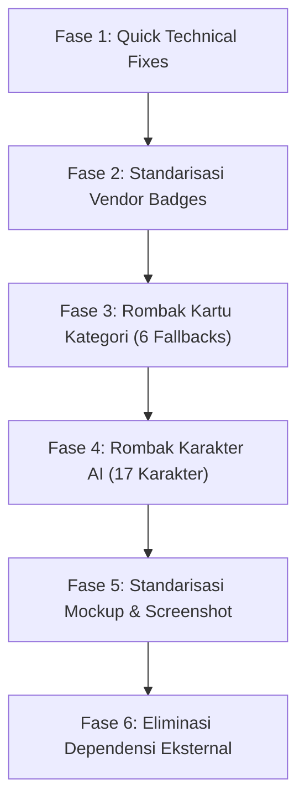

# Inventaris & Panduan Overhaul Aset Gambar Statis (Image Assets SSOT)

**Status:** Dokumen Kerja / Rujukan Overhaul Desain Visual  
**Tanggal:** 31 Oktober 2026  
**Cakupan:** Seluruh aset gambar statis di `public/`, `_docs/assets/`, `ops/products/skills/`, dan dependensi gambar eksternal di `src/data/`.

---

## 1. Ringkasan Eksekutif & Temuan Kritis (Audit Findings)

Dokumen ini mendata seluruh aset gambar statis proyek **AIPEDIA** sebagai dasar persiapan perombakan (*overhaul*) gaya visual agar selaras dengan **Apple Human Interface Guidelines (HIG)** dan estetika **Tactile / Liquid Glass**.

Dari audit menyeluruh terhadap 76 file aset lokal dan 27 dependensi eksternal, ditemukan beberapa **isu teknis & inkonsistensi visual kritis** yang wajib diselesaikan dalam proses overhaul:

| Isu Kritis | Fakta di Lapangan & Root Cause | Dampak | Rekomendasi Solusi |
|---|---|---|---|
| **1. Fake WebP (Ukuran Membengkak)** | 6 file `public/card-*.webp` (~5.2 MB total) sebenarnya adalah **PNG uncompressed (1408×768)** yang hanya diganti ekstensinya menjadi `.webp`. | Loading awal berat, memboroskan bandwidth visitor (~900 KB per kartu). | Konversi ke **True WebP/AVIF** dengan kompresi optimal (< 100 KB per kartu). |
| **2. Resolusi Karakter Belang** | 15 karakter beresolusi 800×800 px, namun **Hima** (`hima.png`) dan **Wita** (`wita.png`) hanya **200×200 px (39-43 KB)**. *Root Cause:* Master Hima & Wita absen di `_docs/assets/raw_icons/`, sehingga file diambil darurat dari thumbnail Codex packaging `ops/products/skills/`. | Hima & Wita pecah/buram saat ditampilkan di layar Retina atau kartu besar. | Render ulang source Hima & Wita ke standar minimum 1024×1024 px. |
| **3. Kanvas & Rasio Karakter Tidak Seragam** | Sebagian karakter dipangkas non-persegi: `mita.png` (599×800), `prima.png` (689×800), `sona.png` (690×800). *Root Cause:* Script `ops/scripts/manager.py:compress_icons()` memakai `img.thumbnail((800, 800))` pada master yang rasio aslinya potret (1024×1367). | Posisi kepala & cropping meleset saat diapit container bulat atau squircle. | Seragamkan semua aset karakter ke **aspek rasio 1:1 murni (1024×1024 px)** dengan padding aman 10% dan modifikasi script agar melakukan square letterbox/pad. |
| **4. Raw Icons Hilang** | Folder master `_docs/assets/raw_icons/` hanya memiliki 15 file (tidak ada master untuk `hima` dan `wita`). | Aset `public/character/hima.png` dan `wita.png` terpaksa diambil dari icon thumbnail Codex (`ops/`). | Tambahkan master source Hima dan Wita ke `_docs/assets/raw_icons/`. |
| **5. Campuran Format Vendor Badges** | Dari 26 vendor, 22 sudah SVG, namun 4 vendor (`midjourney.png`, `codex.png`, `claude.png`, `chatgpt-white.png`) masih berupa raster PNG dengan latar gelap/berwarna. | Tampilan tidak harmonis saat diletakkan di dalam chip/pill Apple tactile terang. | Konversi 100% vendor badge ke **SVG monokrom/clean glyph**. |
| **6. Screenshot Tidak Berbingkai Standar** | `public/screenshots/` memiliki resolusi acak (974×727 hingga 1419×850) tanpa bingkai konsisten. | Tampilan showcase produk terkesan mentah (*raw screen capture*). | Standarisasikan ke **rasio 16:10** dengan **macOS Sequoia window chrome mockup**. |
| **7. Ketergantungan URL Eksternal** | 24+ kartu di `catalog.ts` dan `resources.ts` memakai URL Unsplash & Pexels langsung di frontend. | Rentan *broken link*, *rate limit*, dan gaya fotografi acak-acakan. | Migrasikan gambar ke kartu kategori lokal (`/card-*.webp`) atau kurasi aset lokal seragam. |

---

## 2. Inventaris Lengkap per Kategori

### Kategori A: Avatar Karakter AI Spesialis (`public/character/*.png`)
Digunakan pada kartu spesialis, sales landing page (`/mita`, `/teja`), katalog, data tiering (`src/data/assistants.ts`, `src/data/characters.json`), serta SSOT database (`_docs/database/assistants.json`).

| Nama File | Karakter | Peran / Spesialisasi | Dimensi Saat Ini | Format / Mode | File Size | Status Source Master (`_docs/assets/raw_icons/`) | Kebutuhan Overhaul |
|---|---|---|---|---|---|---|---|
| `mita.png` | **Mita** | Meta Ads & Funnel | 599×800 px | PNG RGBA | 436 KB | ✅ Ada (1024×1367) | Render ulang 1:1 (1024×1024), centering badan & kepala |
| `teja.png` | **Teja** | Teknis & Otomasi Workflow | 800×800 px | PNG RGBA | 427 KB | ✅ Ada (1600×1600) | Sesuaikan lighting & material baru |
| `wita.png` | **Wita** | Copywriting & Konten Iklan | **200×200 px** ⚠️ | PNG RGBA | 43 KB | ❌ **Hilang** (perlu render baru) | **P0:** Render ulang resolusi tinggi 1024×1024 |
| `gita.png` | **Gita** | Visual Ads & Branding | 800×800 px | PNG RGBA | 368 KB | ✅ Ada (1600×1600) | Sesuaikan lighting & material baru |
| `wilo.png` | **Wilo** | Website & Landing Page | 800×800 px | PNG RGBA | 446 KB | ✅ Ada (1600×1600) | Sesuaikan lighting & material baru |
| `fina.png` | **Fina** | Finance & Kas Bisnis | 800×800 px | PNG RGBA | 524 KB | ✅ Ada (1024×1024) | Sesuaikan lighting & material baru |
| `wanda.png` | **Wanda** | WhatsApp Sales Closing | 800×800 px | PNG RGBA | 366 KB | ✅ Ada (1600×1600) | Sesuaikan lighting & material baru |
| `sona.png` | **Sona** | Social Media Content | 690×800 px | PNG RGBA | 462 KB | ✅ Ada (986×1144) | Render ulang 1:1 (1024×1024) |
| `loka.png` | **Loka** | Marketplace & E-commerce | 800×800 px | PNG RGBA | 349 KB | ✅ Ada (1600×1600) | Sesuaikan lighting & material baru |
| `dany.png` | **Dany** | Data & Metrik Bisnis | 800×800 px | PNG RGBA | 504 KB | ✅ Ada (1024×1024) | Sesuaikan lighting & material baru |
| `beny.png` | **Beny** | Strategi Bisnis UMKM | 800×800 px | PNG RGBA | 498 KB | ✅ Ada (1024×1024) | Sesuaikan lighting & material baru |
| `selo.png` | **Selo** | SEO & Organic Growth | 800×800 px | PNG RGBA | 540 KB | ✅ Ada (1024×1024) | Sesuaikan lighting & material baru |
| `hima.png` | **Hima** | Local SEO & Google Maps | **200×200 px** ⚠️ | PNG RGBA | 39 KB | ❌ **Hilang** (perlu render baru) | **P0:** Render ulang resolusi tinggi 1024×1024 |
| `cisa.png` | **Cisa** | Customer Relation & Retensi | 800×800 px | PNG RGBA | 611 KB | ✅ Ada (1024×1024) | Sesuaikan lighting & material baru |
| `viko.png` | **Viko** | Video Script TikTok/Reels | 800×800 px | PNG RGBA | 574 KB | ✅ Ada (1024×1024) | Sesuaikan lighting & material baru |
| `lila.png` | **Lila** | Live Selling & Host Script | 800×800 px | PNG RGBA | 421 KB | ✅ Ada (1600×1600) | Sesuaikan lighting & material baru |
| `prima.png` | **Prima** | SOP & Operasional Tim | 689×800 px | PNG RGBA | 425 KB | ✅ Ada (1022×1186) | Render ulang 1:1 (1024×1024) |

---

### Kategori B: Thumbnail Kartu & Fallback Kategori (`public/card-*.webp`)
Digunakan sebagai cover visual kartu sumber daya di `src/components/ResourceCard.astro`, `src/components/cards/CourseCard.astro`, `src/components/cards/StandardCard.astro`, dan `src/pages/index.astro`.

| Nama File | Tipe Konten / Kategori | Dimensi Riil | Format Nyata | Ukuran Saat Ini | Rekomendasi Format & Target Size | Arah Visual Baru |
|---|---|---|---|---|---|---|
| `card-prompt-teks.webp` | Prompt Teks (LLM/ChatGPT) | 1408×768 px | PNG (RGB) | 850 KB ⚠️ | True WebP (1200×675, 16:9), < 90 KB | 3D Typographic Pill + macOS Text Terminal Glass |
| `card-prompt-visual.webp` | Prompt Visual (Midjourney) | 1408×768 px | PNG (RGB) | 862 KB ⚠️ | True WebP (1200×675, 16:9), < 90 KB | 3D Aperture Lens / Prism Glass Refraction |
| `card-skill-agent.webp` | Custom AI Skill & Agent | 1408×768 px | PNG (RGB) | 872 KB ⚠️ | True WebP (1200×675, 16:9), < 90 KB | Tactile Chip Core / Apple Neural Engine Motif |
| `card-tutorial.webp` | Video / Panduan Praktis | 1408×768 px | PNG (RGB) | 829 KB ⚠️ | True WebP (1200×675, 16:9), < 90 KB | Floating macOS Window Player + Playhead Glow |
| `card-konten.webp` | Template Konten & Copywriting | 1408×768 px | PNG (RGB) | 903 KB ⚠️ | True WebP (1200×675, 16:9), < 90 KB | Stack of Tactile Index Cards / Paper Material |
| `card-preset.webp` | Default General Preset | 1408×768 px | PNG (RGB) | 820 KB ⚠️ | True WebP (1200×675, 16:9), < 90 KB | Minimalist Cupertino Grid & Glass Spheres |

---

### Kategori C: Vendor & Tool Brand Badges (`public/vendors/*`)
Digunakan di `src/components/ToolBadge.astro`, `src/components/PlatformGrid.astro`, dan landing page `/teja` & `/mita`.

| Vendor / Platform | File Saat Ini | Format | Dimensi | Rekomendasi Overhaul |
|---|---|---|---|---|
| **ChatGPT** | `chatgpt.svg` + `chatgpt-white.png` | SVG + PNG | Vector / 1024×1024 | Hapus PNG, gunakan satu `chatgpt.svg` adaptif |
| **Claude** | `claude.svg` + `claude.png` | SVG + PNG | Vector / 1024×1024 | Hapus PNG, gunakan satu `claude.svg` clean vector |
| **Codex** | `codex.png` | **PNG (Paletted)** | 640×640 px | Ganti dengan SVG vector resmi Codex/OpenAI |
| **Midjourney** | `midjourney.png` | **PNG (RGBA)** | 1024×1024 px (158 KB) | Ganti dengan SVG vector sailboat Midjourney |
| **Anthropic** | `anthropic.svg` | SVG | Vector | Pertahankan (sudah clean vector) |
| **Gemini** | `gemini.svg` | SVG | Vector | Pertahankan |
| **DeepSeek** | `deepseek.svg` | SVG | Vector | Pertahankan |
| **OpenAI** | `openai.svg` | SVG | Vector | Pertahankan |
| **Perplexity** | `perplexity.svg` | SVG | Vector | Pertahankan |
| **Mistral** | `mistral.svg` | SVG | Vector | Pertahankan |
| **Meta** | `meta.svg` | SVG | Vector | Pertahankan |
| **Figma** | `figma.svg` | SVG | Vector | Pertahankan |
| **Canva** | `canva.svg` | SVG | Vector | Pertahankan |
| **Notion** | `notion.svg` | SVG | Vector | Pertahankan |
| **Zapier** | `zapier.svg` | SVG | Vector | Pertahankan |
| **Make** | `make.svg` | SVG | Vector | Pertahankan |
| **Google Docs** | `googledocs.svg` | SVG | Vector | Pertahankan |
| **Google Sheets**| `googlesheets.svg` | SVG | Vector | Pertahankan |
| **GitHub** | `github.svg` | SVG | Vector | Pertahankan |
| **Discord** | `discord.svg` | SVG | Vector | Pertahankan |
| **Slack** | `slack.svg` | SVG | Vector | Pertahankan |
| **Vercel** | `vercel.svg` | SVG | Vector | Pertahankan |
| **ElevenLabs** | `elevenlabs.svg` | SVG | Vector | Pertahankan |
| **HuggingFace** | `huggingface.svg` | SVG | Vector | Pertahankan |

---

### Kategori D: Screenshot & Product Showcase (`public/screenshots/*` & `public/images/*`)
Digunakan untuk pembuktian produk pada hero section dan alur kerja di sales page.

| File Path | Lokasi Pemakaian | Dimensi Saat Ini | Ukuran | Format | Target Standarisasi Overhaul |
|---|---|---|---|---|---|
| `public/screenshots/hero.png` | Showcase landing page | 1250×842 px | 865 KB | PNG RGBA | 1920×1200 px (16:10), retina macOS Sequoia frame, WebP (< 250 KB) |
| `public/screenshots/1.png` | Sales Page (`/mita`, `/teja`) | 1310×790 px | 10 KB | PNG-8 (P) | Mockup step 1 berseragam, rasio 16:10 konsisten |
| `public/screenshots/2.png` | Sales Page (`/mita`, `/teja`) | 974×727 px | 16 KB | PNG-8 (P) | Mockup step 2 berseragam, rasio 16:10 konsisten |
| `public/screenshots/3.png` | Sales Page (`/mita`, `/teja`) | 1419×850 px | 25 KB | PNG-8 (P) | Mockup step 3 berseragam, rasio 16:10 konsisten |
| `public/screenshots/4.png` | Sales Page (`/mita`, `/teja`) | 1136×655 px | 19 KB | PNG-8 (P) | Mockup step 4 berseragam, rasio 16:10 konsisten |
| `public/screenshots/5.png` | Sales Page (`/mita`, `/teja`) | 1167×802 px | 29 KB | PNG-8 (P) | Mockup step 5 berseragam, rasio 16:10 konsisten |
| `public/screenshots/6.png` | Sales Page (`/mita`, `/teja`) | 991×653 px | 20 KB | PNG-8 (P) | Mockup step 6 berseragam, rasio 16:10 konsisten |
| `public/images/Screenshot_2026-07-02_at_05.35.47.png` | Arsip UI | 1286×692 px | 270 KB | PNG | Pindahkan ke `_docs/assets/screenshot/` (bukan public) |
| `public/images/Screenshot_2026-07-02_at_13.21.43.png` | Arsip UI | 1265×710 px | 278 KB | PNG | Pindahkan ke `_docs/assets/screenshot/` (bukan public) |

---

### Kategori E: Aset Kemasan Produk / Customer Deliverables (`ops/products/skills/`)
Digunakan saat generator `ops/products/build.sh` memaketkan ZIP/PDF bonus spesialis untuk pembeli.

| File Path | Dimensi | Karakter Terkait | Catatan |
|---|---|---|---|
| `ops/products/skills/codex/skills/hima/icon.png` | 200×200 px | Hima | Identik dengan `public/character/hima.png` |
| `ops/products/skills/codex/skills/wita/icon.png` | 200×200 px | Wita | Identik dengan `public/character/wita.png` |
| `ops/products/skills/codex/skills/mita/icon.png` | 150×200 px | Mita | Crop vertikal non-standar |
| `ops/products/skills/codex/skills/sona/icon.png` | 172×200 px | Sona | Crop vertikal non-standar |
| `ops/products/skills/codex/skills/prima/icon.png`| 172×200 px | Prima | Crop vertikal non-standar |
| `ops/products/skills/codex/skills/{beny,cisa,dany,fina,selo,viko}/icon.png` | 200×200 px | Berbagai | Thumbnail paket download |
| `ops/products/skills/codex/assets/icon.png` & `logo.png` | 640×640 px | Brand Codex | Logo bundle |

---

### Kategori F: Dependensi Gambar Eksternal (Unsplash & Pexels)
Daftar aset remote yang saat ini di-*load* dari pihak ketiga dan direncanakan untuk distandarisasi/dilokalkan:

| Domain / URL | File Kode | Pemakaian | Strategi Overhaul |
|---|---|---|---|
| `images.unsplash.com/photo-1551288049-bebda4e38f71` | `src/pages/index.astro:121` | Mockup preview beranda | Ganti dengan mockup lokal WebP resmi `public/screenshots/hero.webp` |
| 14 URL Unsplash | `src/data/catalog.ts` | Cover thumbnail kursus/prompt | Ganti dengan `public/card-*.webp` sesuai kategori, atau sediakan thumbnail kurasi lokal |
| 10 URL Pexels | `src/data/resources.ts` | Cover thumbnail library | Ganti dengan fallback `public/card-*.webp` terstandarisasi |
| 3 URL Unsplash | `src/data/news.ts` | Cover artikel berita AI | Ganti dengan cover editorial lokal atau fallback seragam |

---

## 3. Blueprint & Arahan Desain Overhaul (Apple HIG & Tactile Aesthetic)

Arah estetika visual baru untuk AIPEDIA mengacu pada prinsip **Apple Human Interface Guidelines (HIG)** dan material **Liquid Glass / Tactile Neomorphic**:

```text
┌────────────────────────────────────────────────────────────────────────┐
│                        AIPEDIA VISUAL IDENTITY                         │
│                                                                        │
│   [ 3D Tactile Clay / Matte ]     +    [ Translucent Liquid Glass ]   │
│   • Subjek karakter berbobot           • Material kaca frosted         │
│   • Top-left soft key light            • Specular rim light tipis      │
│   • Natural ambient occlusion          • Subsurface scattering lembut  │
│   • Transparent alpha background       • Background mesh gradient      │
└────────────────────────────────────────────────────────────────────────┘
```

### 1. Avatar Karakter AI Spesialis (17 Karakter)
- **Style:** **3D Matte Clay / Semi-Realistic Stylized Avatar** (seperti gaya visual Apple Memoji Pro / 3D Iconography macOS modern).
- **Komposisi:** Bust-up / portrait dari dada ke atas, menghadap depan atau 15° three-quarter view, ekspresi profesional ramah (*business-approachable*).
- **Kanvas & Format:**
  - Ukuran: **1024×1024 px** murni (1:1 aspect ratio).
  - Background: **Transparent (RGBA)**, zero margin bleed (padding sekitar subjek 8–10% agar tidak terpotong saat dimasukkan ke dalam container squircle/lingkaran).
  - Format rilis: WebP lossless / optimized PNG (< 180 KB per karakter).
- **Pencahayaan & Warna:**
  - Key light lembut dari sudut kiri atas (ambient white `#FFFFFF`, fill light lembut `#E2E8F0`).
  - Subtle colored rim light (edge lighting) yang disesuaikan dengan domain tier spesialis:
    - **Tier 1 (Acquisition - Mita, Wita, Gita, Wilo, Sona):** Aksen Blue / Amber glow halus.
    - **Tier 2 (Pain Points - Fina, Wanda, Tira):** Aksen Emerald / Warm Gold glow halus.
    - **Tier 3 (Supporting - Loka, Dany, Hima, dll.):** Aksen Indigo / Slate neutral.

### 2. Thumbnail Kartu & Fallback Kategori (`card-*.webp`)
- **Style:** **Apple Liquid Glass Canvas** dengan objek 3D representatif melayang (*floating tactile object*), bayangan lembut multi-layer, dan mesh gradient latar yang tenang.
- **Kanvas & Format:**
  - Ukuran: **1200×675 px** (16:9 widescreen rasio standar).
  - Format: **True WebP** (quality 85–90, file size wajib di bawah **100 KB** per kartu).
- **Palet Warna Per Kategori:**
  1. `card-prompt-teks`: Latar Deep Navy `#0F172A` ke `#1E293B`, aksen Blue Sapphire `#0284C7`.
  2. `card-prompt-visual`: Latar Deep Violet `#1E1B4B` ke `#312E81`, aksen Iris Purple `#8B5CF6`.
  3. `card-skill-agent`: Latar Dark Emerald `#064E3B` ke `#0F766E`, aksen Mint Aqua `#10B981`.
  4. `card-tutorial`: Latar Rich Amber `#451A03` ke `#78350F`, aksen Sunset Gold `#F59E0B`.
  5. `card-konten`: Latar Rose Crimson `#4C0519` ke `#881337`, aksen Coral Peach `#FB7185`.
  6. `card-preset`: Latar Frosted Charcoal `#18181B` ke `#27272A`, aksen Cool Silver `#E4E4E7`.

### 3. Vendor Platform Badges (`public/vendors/`)
- **Style:** **Clean Vector Glyphs** (100% SVG).
- **Standarisasi:**
  - `viewBox="0 0 24 24"` seragam.
  - Warna default `currentColor` agar dapat otomatis mengikuti warna teks/chip CSS token (`var(--color-ink-muted)` atau `var(--color-ink-faint)`).
  - Tidak ada latar kotak berwarna keras (kotak background diatur oleh wrapper `.tool-badge` CSS).

### 4. Product Screenshots & Mockup Frames
- **Style:** **macOS Window Frame (Sequoia / Sonoma Glass Chrome)**.
- **Elemen Frame:**
  - Tiga tombol kontrol jendela (Red `#FF5F56`, Yellow `#FFBD2E`, Green `#27C93F`) di kiri atas.
  - Radius sudut frame: `16px` dengan hairline border `1px solid rgba(255, 255, 255, 0.2)` dan outer shadow `0 20px 40px -15px rgba(0, 0, 0, 0.3)`.
  - Format file: WebP terkompresi (< 200 KB) dengan rasio 16:10 (misal 1600×1000 px).

---

## 4. Prompt Engineering & Panduan Generator Gambar Baru

Bagi desainer atau agent AI yang akan me-*generate* aset karakter atau kartu baru, gunakan panduan prompt terstruktur berikut:

### Master Prompt Template: Karakter Spesialis (Midjourney v6 / Ideogram / Flux)
```text
3D stylized bust portrait of [CHARACTER NAME], an Indonesian professional [JOB ROLE], 
warm and approachable friendly expression, modern minimalist business casual attire, 
Pixar meets Apple Memoji style, soft matte clay material, subsurface scattering, 
clean geometric shapes, soft diffused studio lighting from top-left, 
subtle rim light, pure transparent solid background, centered composition, 
high detail 8k render, isolated on alpha background --ar 1:1 --style raw
```

### Master Prompt Template: Thumbnail Kartu Liquid Glass
```text
Modern minimalist isometric floating icon of [OBJECT REPRESENTING CATEGORY, e.g. glass terminal / aperture lens / tactile CPU chip], 
crafted from translucent frosted Apple Liquid Glass material with refractive glass edges, 
floating above a sleek dark minimal surface, ambient mesh gradient background in [COLOR PALETTE], 
tactile neomorphic feel, studio product lighting, volumetric glow, octane render, 8k --ar 16:9
```

---

## 5. Roadmap & Urutan Eksekusi Overhaul (Action Plan)



### Rincian Tahapan:

- **Fase 1: Quick Technical Fixes (P0)**
  - Konversi 6 file `public/card-*.webp` yang saat ini berformat PNG asli (850-903 KB) menjadi **True WebP compressed** (target < 90 KB). Menghemat ~4.5 MB bandwidth seketika.
  - Rapikan direktori `public/images/`: arsipkan screenshot manual lawas ke `_docs/assets/screenshot/`.

- **Fase 2: Standarisasi Vendor Badges (P1)**
  - Ganti 4 vendor raster (`midjourney.png`, `codex.png`, `claude.png`, `chatgpt-white.png`) dengan SVG vector resmi.
  - Pastikan semua SVG memakai atribut `viewBox="0 0 24 24"` dan mendukung pewarnaan CSS token.

- **Fase 3: Rombak Kartu Kategori Fallback (P1)**
  - Render 6 visual kartu baru bergaya Liquid Glass 16:9 (1200×675 px).
  - Terapkan ke `public/card-*.webp`.

- **Fase 4: Rombak Karakter Spesialis AI (P1)**
  - Prioritaskan pembuatan ulang source master resolusi tinggi untuk **Hima** dan **Wita** (saat ini darurat 200×200 px).
  - Samakan kanvas semua 17 karakter ke 1:1 (1024×1024 px) dengan gaya 3D Matte Clay yang seragam.
  - Ekspor ke `public/character/*.png` (dan mirror ke `ops/products/skills/codex/skills/*/icon.png` untuk packaging).

- **Fase 5: Standarisasi Mockup & Screenshot (P2)**
  - Ambil screenshot antarmuka terbaru dengan bingkai macOS Sequoia window chrome.
  - Ganti `public/screenshots/hero.png` dan `1.png` - `6.png` dengan rasio 16:10 beresolusi tinggi.

- **Fase 6: Eliminasi Dependensi Eksternal (P2)**
  - Perbarui data di `src/data/catalog.ts` dan `src/data/resources.ts` agar merujuk ke kartu kategori lokal daripada URL Unsplash/Pexels remote.

---

## 6. Sinkronisasi Pipeline Otomasi (`ops/scripts/manager.py`)

AIPEDIA memiliki script manajemen otomatis di `ops/scripts/manager.py`. Saat overhaul visual dilakukan, fungsi script berikut perlu diselaraskan:

1. **`generate_visual_prompts()`**
   - Update string `PROMPT_GENERATOR` (line 32-42) agar menggunakan prompt master 3D Matte Clay / Apple Memoji modern di atas, menggantikan deskripsi robot chibi lama.
2. **`compress_icons()`**
   - Perbaiki handling kanvas agar selalu menghasilkan output **1:1 square RGBA** (bukan sekadar `thumbnail()` yang mempertahankan aspek rasio potret bawaan sumber).
   - Tambahkan fallback auto-centering / square canvas padding transparan jika file input berdimensi non-persegi.
3. **Penyimpanan Source Master Baru**
   - Simpan seluruh 17 master icon resolusi tinggi (1024×1024 atau 1600×1600 px) di `_docs/assets/raw_icons/[id].png`.
   - Jalankan `python3 ops/scripts/manager.py compress-icons` untuk auto-deploy ke `public/character/` dan generate thumbnail untuk `ops/products/skills/codex/`.

---

> **Catatan Pengawasan:** Sesuai instruksi pengerjaan, seluruh perubahan visual dan file aset pada repositori disimpan pada working tree lokal tanpa commit git otomatis sampai seluruh rangkaian desain disetujui.
